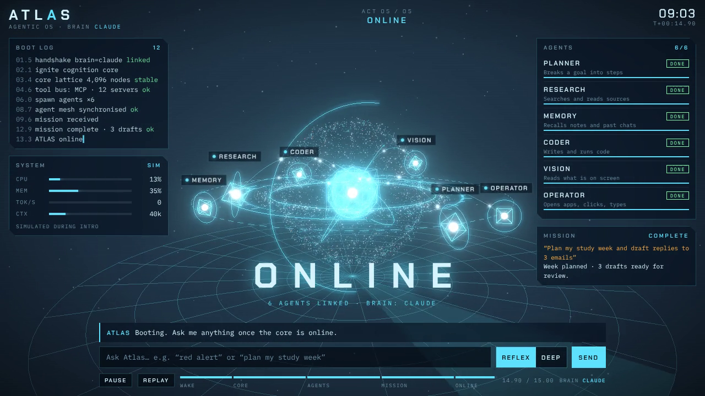

# ATLAS · Agentic OS

A 15-second Three.js boot sequence that ends on a JARVIS-style dashboard. When you run it on your laptop, Claude is the brain behind it.



🎬 **Video:** [`media/atlas-15s.mp4`](media/atlas-15s.mp4) (1280×720, 30 fps, rendered frame by frame)

## The 15 seconds

| Act | Time | What happens |
|---|---|---|
| 01 Wake | 0–2.5 s | A spark ignites. The boot log starts typing. Dust drifts in deep space. |
| 02 Core | 2.5–6 s | 4,096 particles swirl into the cognition core. The icosahedron core and the HUD rings lock in. |
| 03 Agents | 6–9.5 s | Six agents spawn on an orbit (Planner, Research, Memory, Coder, Vision, Operator). Beams connect them to the core and a holographic floor appears. |
| 04 Mission | 9.5–13 s | A task arrives ("Plan my study week…"). Agents run in turn, the voice ring pulses, and the gauges spike. |
| 05 Online | 13–15 s | A shockwave goes out, the title reads ONLINE, and the camera settles into live mode. |

After 15 seconds the dashboard stays live with a slow orbit, and the command bar works.

## Run it

```bash
npm install
export ANTHROPIC_API_KEY=sk-ant-...      # from console.anthropic.com
npm start                                 # → http://127.0.0.1:7777
```

- **No key?** The page still runs. The brain falls back to **demo** replies.
- **Controls:** `Space` pauses, `R` replays, and you can click the timeline to scrub.
- **Try:** "red alert", "stand down", "plan my study week", "how's my laptop doing?"

## How the brain works

```
browser (index.html)  ──POST /api/ask──▶  brain/server.mjs  ──▶  Claude API (claude-opus-5-5)
        ▲                                        │
        └──── NDJSON: text deltas + UI tool events (alert, mission, focus, laptop stats)
```

- The API key stays in the Node process and never reaches the browser.
- Claude gets four tools:
  - `run_mission`, `set_alert_level` and `focus_agent` drive the dashboard.
  - `get_laptop_status` reads your real CPU, memory and uptime.
- The server listens on `127.0.0.1` only, so nothing else on your network can reach it.
- **Reflex** runs Claude at low effort for fast replies. **Deep** runs it at high effort.
- Opened as a **Claude artifact**, the same page uses the viewer's own Claude account (`window.claude` → `sample`). No server or key is needed.

## Record the video yourself

```bash
npx playwright install chromium   # once
npm run record                    # → media/atlas-15s.mp4
npm run record -- --w 1920 --h 1080 --fps 60
```

## Files

```
index.html          the whole scene + HUD (three.js 0.170.0 from jsDelivr)
brain/server.mjs    local bridge to Claude + static server
scripts/record.mjs  deterministic frame-by-frame MP4 renderer
media/              rendered video + poster
```

## Make it a real agentic OS

This project is a **UI plus a chat brain**. To let Claude actually *do* things on your laptop, add hands:

1. **Claude Agent SDK** (`@anthropic-ai/claude-agent-sdk`): Claude Code as a library. It comes with file, bash, web, subagent and MCP tools. Swap `brain/server.mjs`'s Messages API loop for `query()`.
2. **MCP servers** for each capability: filesystem, git, calendar, browser and so on.
3. **Computer use** (`computer_toolset_20260801`) for screen-level control. Run it in a VM or limited user account.
4. **Shell:** wrap the page in **Tauri** or **Electron** as a desktop app, or set it as an interactive wallpaper with **Lively Wallpaper** (Windows, free and open source).

⚠️ **Auth rule:** apps built on the API or the Agent SDK must use an **API key**, billed per token. Anthropic's docs say third-party apps may not use claude.ai Pro/Max login unless Anthropic has approved it.

## License

MIT. three.js is MIT-licensed.
