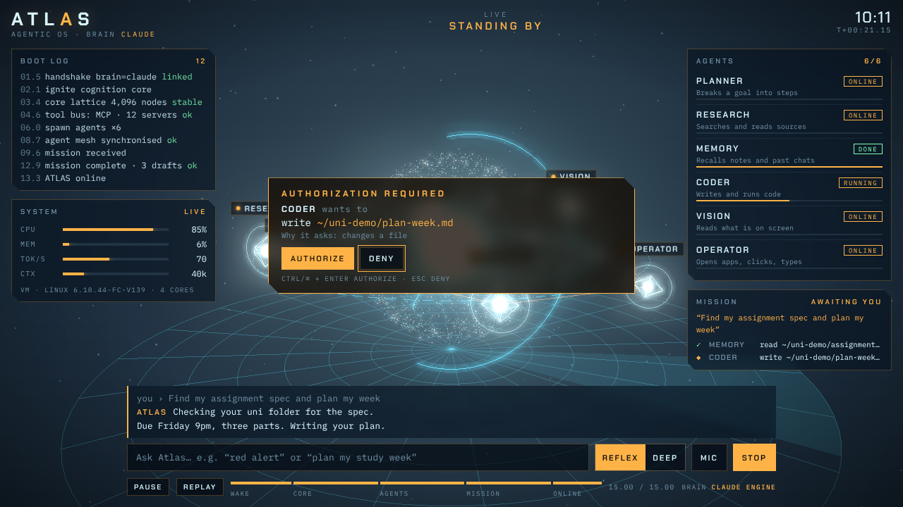

# ATLAS · Agentic OS

A JARVIS-style 3D HUD for your laptop. **Claude is the brain**, running on Anthropic's official agent engine, the **Claude Agent SDK** (the same engine as Claude Code). ATLAS can read, search, write and run things on your machine. Anything that changes your laptop stops on the HUD until you **authorize** it.



🎬 [`media/atlas-30s.mp4`](media/atlas-30s.mp4): the 15-second boot sequence, then ATLAS doing a task (scripted demo).

## Why this setup (market check, October 2026)

No single product beats ATLAS on both looks and capability, so ATLAS combines the best of each:

| Option | Looks | Real tasks on your laptop | Notes |
|---|---|---|---|
| Claude Desktop + Cowork | plain chat | ✅ the strongest (files, computer use, Chrome) | needs a paid plan; the official choice if you don't need the HUD |
| OpenClaw (≈392k★) | chat apps | ✅ | many security advisories; tools run on the host by default |
| Goose (Linux Foundation) | chat | ✅ via MCP | a solid open-source option |
| JARVIS hobby repos | HUD | partial | small and unaudited; one skips all permissions |
| **ATLAS** (this repo) | **3D HUD** | ✅ via the Claude Agent SDK | ATLAS's look plus the official engine, with authorization on every change |

## Run it

```bash
npm install
export ANTHROPIC_API_KEY=sk-ant-...     # from platform.claude.com
npm start                                # → http://127.0.0.1:7777
```

- **Try saying:**
  - "what's in my Downloads folder?"
  - "summarise ~/uni/notes.md"
  - "plan my week from my timetable"
  - "red alert"
  - "how's my laptop doing?"
- **Reflex** runs Claude at low effort for speed. **Deep** runs it at high effort for harder work.
- **Keys:**
  - `Ctrl/⌘ + Enter` authorizes and `Esc` denies.
  - `Space` pauses the intro and `R` replays it.
  - **Stop** cancels a running task.
- **Two other ways to open it:**
  - Opened as a **Claude artifact**, it talks through your own Claude account and drives the HUD. It can't touch files there.
  - Opened as a plain file, it plays a scripted demo. Add `#tour` to the URL to watch it run itself.

## What it can do

The engine brings Claude Code's tools: read and search files, write and edit them, run commands, search and read the web, plan, and delegate to subagents. Each tool lights up a node on the HUD:

| Agent | Tools | Goes through on its own? |
|---|---|---|
| MEMORY | Read, Grep, Glob | ✅ (sensitive files such as `.ssh`, `.env` or keys are held) |
| RESEARCH | WebSearch, WebFetch | ✅ |
| PLANNER | TodoWrite, subagents | ✅ |
| OPERATOR | Bash | read-only commands (`ls`, `cat`, `git status`…) ✅; everything else is **held** |
| CODER | Write, Edit | **held** (set `ATLAS_AUTO_EDITS=1` to allow edits inside the workspace) |
| VISION | images and PDFs; HUD tools (alert, focus, laptop stats) | ✅ |

ATLAS's own policy, in `brain/policy.mjs`, decides what's held. It overrides the engine even where Claude Code would allow an action by itself. When you deny an action, Claude is told and adapts.

## Settings

| Variable | Default | Meaning |
|---|---|---|
| `ATLAS_MODEL` | `claude-opus-5-5` | `claude-sonnet-5-5` or `claude-haiku-5-5` are cheaper |
| `ATLAS_WORKSPACE` | your home folder | the folder Claude works in |
| `ATLAS_AUTO_EDITS` | off | `1` lets file edits inside the workspace through without asking |
| `ATLAS_BUDGET_USD` | `2` | spending cap per request |
| `ATLAS_OWNER` | your login name | what ATLAS calls you |

## Cost and sign-in

- **API key, not your subscription.** ATLAS uses an API key, billed per token. Anthropic's terms say apps built on the Agent SDK must use API keys, not a Pro or Max login.
- **Prices per million tokens:**

  | Model | Input | Output |
  |---|---|---|
  | Opus 5.5 | $4 | $20 |
  | Sonnet 5.5 | $2 | $10 |
  | Haiku 5.5 | $0.10 | $0.50 |

- **Spending cap:** each request stops at `ATLAS_BUDGET_USD`. The reply shows what it cost.

## Safety

- **The server only answers your own tab.**
  - It listens on `127.0.0.1` only.
  - Each launch has a random token, and every API call must present it.
  - Requests for any other host name are refused.
- **Your API key stays in the server process** and never reaches the page.
- **The engine is isolated from your `~/.claude` settings** (`settingSources: []`), so ATLAS's policy is the authority on what's allowed.
- **ATLAS can't click around your screen.** It works through files, commands and the web. For full computer use, Claude Desktop's Cowork is the official route.

## Tests

```bash
npm test
```

- **31 policy checks:** what goes through and what's held.
- **18 end-to-end checks.** These run the real Claude Agent SDK engine against a scripted stand-in for the Claude API. They cover:
  - reads going through
  - writes and deletes held
  - deny and authorize both working
  - Claude being told about a denial
  - the HUD's red-alert tool
  - session memory across requests
  - the token and host checks
  - the no-key message

## Files

```
index.html          the HUD: 15 s three.js boot sequence, live agents, activity, authorization panel
brain/server.mjs    local server: Claude Agent SDK engine, hooks + approvals, HUD tools, token/host checks
brain/policy.mjs    what goes through and what's held; which agent lights up
test/               policy + end-to-end tests
scripts/record.mjs  renders the video frame by frame
```

## Limits

- I tested this on Linux only, in headless Chromium and against a mock API. **macOS and Windows are untested.** The Agent SDK ships its engine for both.
- The engine adds about 240 MB to `node_modules`, because Claude Code's native binary comes with it.
- "ATLAS" shares its name with OpenAI's ChatGPT Atlas browser. Rename it if that bothers you; nothing depends on the name.

MIT licensed. three.js is MIT.
