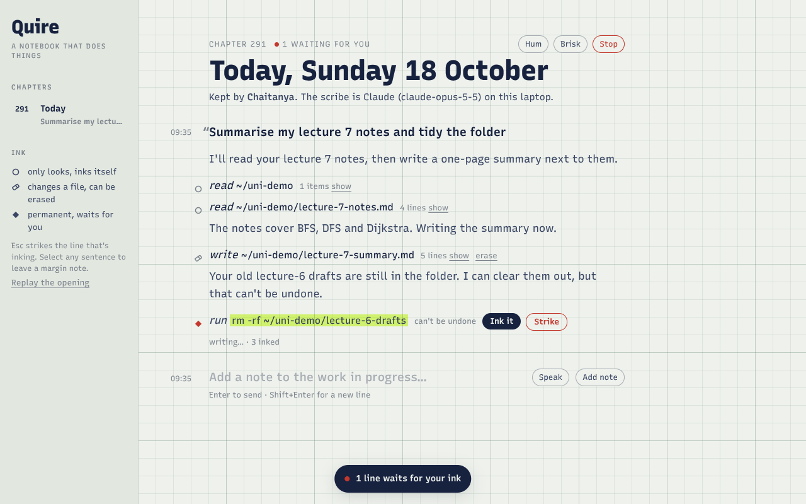

# Quire

**A personal operating system shaped like a notebook.** Claude is the scribe. It writes what it means to do in **pencil**. What only *looks* inks itself. Changes to files ink themselves after a pause, and every one can be **erased**. Anything **permanent** stays in pencil until you ink it. Strike out any line you don't want.



🎬 Opening: [`media/quire-opening-15s.mp4`](media/quire-opening-15s.mp4) · Demo: [`media/quire-tour.webm`](media/quire-tour.webm)

---

## Why it's different

Most agent UIs are a chat window plus permission pop-ups ("Allow this command?"). After the tenth pop-up you stop reading them. Quire replaces both with one grammar everyone already knows from paper:

| On the page | What it means | What you do |
|---|---|---|
| *pencil* (grey, hand-lettered) | Claude intends this, but it hasn't happened | nothing, or **Strike** |
| ink seeping along the line | it will happen in a moment | **Esc** to strike it |
| **ink** (solid, upright) | it happened | **erase** it, if it changed a file |
| ~~red strike~~ | you said no, and Claude was told | — |
| highlighted pencil + ◆ | permanent: it waits for you | **Ink it** or **Strike** |

The pencil-to-ink change is a real typographic transition. Quire animates the **Casual axis of the Recursive variable font** (`CASL 1 → 0`), so the letters firm up as an action commits.

Four more ideas sit around that core:

- **The book.** Each day is a chapter, saved as plain Markdown in `~/.quire/book/`. You can read it without Quire, and Claude reads past chapters as its memory.
- **Margin notes.** Select any words Claude wrote and leave a note in the margin. If Claude is still working, the note reaches it at its very next step, so you can steer it without stopping it.
- **The hum** (optional). You can *hear* Claude work: a soft note for each read, a warmer one for each change, a breath for each web look-up, and a bell when something waits for you. Leave it running in another window and you'll know when to look.
- **The opening.** Once a day, a 15-second three.js scene plays. A lamp clicks on, the notebook opens, and your past chapters riffle by. Today's page writes itself, then the camera sinks into the paper and hands over to the real UI. three.js loads only for those 15 seconds and is disposed afterwards.

**Prior art, honestly.**
- Pausing for approval, checkpoints, sound cues for agents and daily-Markdown memory all exist elsewhere (Claude Code `/rewind`, Cline checkpoints, Agent FM, OpenClaw).
- A prior-art search found no agent that does these three things:
  - shows approval *typographically*, as pencil → ink in a prose log;
  - runs reversible actions after a delay unless you strike them;
  - marks every line with its permanence.
- That combination is what's new here.

## Run it on your laptop

```bash
npm install
export ANTHROPIC_API_KEY=sk-ant-...     # https://platform.claude.com
npm start                                # → http://127.0.0.1:4417
```

Open it in Chrome, Edge, Safari or Firefox. Pin the tab or install it as an app ("Install page as app" in Chrome/Edge) and it behaves like a desktop program.

- **Without a key**, the notebook still opens, but Claude can't write.
- **Without the server** (open `quire.html` directly), you get a scripted demo on a pretend "sandbox shelf". Add `#tour` to the URL to watch it play itself.
- **As a Claude artifact**, the same page uses the viewer's own Claude account on the sandbox shelf. It needs no key and never touches a real computer.

## What Claude can do

| Tool | Ink | Notes |
|---|---|---|
| Read files and folders (`text_editor`) | ○ looks | Inside your shelves. Sensitive files (`.ssh`, `.env`, keys) and anything outside the shelves wait. |
| Create and edit files (`text_editor`) | ⌫ erasable | Snapshotted first. Erasing restores the file and also undoes later changes to the same file. |
| `run_command` | ○ or ◆ | Read-only commands (`ls`, `cat`, `grep`, `git status`…) ink themselves. Everything else waits. |
| `open_item` | ○ or ◆ | Documents, folders and https links ink themselves. Programs and scripts wait. |
| `web_search`, `web_fetch` | ○ looks | Run on Anthropic's side. |

The command line covers almost everything else: Python, git, file moves, installs. Anything that isn't read-only stays in pencil until you ink it.

## Settings: `~/.quire/config.json`

```json
{
  "owner": "Chaitanya",
  "model": "claude-opus-5-5",
  "effort": "medium",
  "shelves": ["~"],
  "inkErasable": "auto",
  "seepMs": { "look": 700, "erasable": 2600 }
}
```

- **`shelves`** are the folders Claude may read and change without asking. Narrow them, for example to `["~/uni", "~/Documents"]`.
- **`inkErasable: "ask"`** makes every file change wait for you too.
- **`model`** can be `claude-sonnet-5-5` or `claude-haiku-5-5` to cut cost.
- **`~/.quire/standing-orders.md`** holds tasks that run each morning when you first open the new chapter.

## Cost

Quire uses the Claude API, billed per token. You can't use a Claude Pro or Max subscription instead: Anthropic's terms require API-key authentication for apps you build yourself.

| Model | Input / output per million tokens |
|---|---|
| Opus 5.5 | $4 / $20 |
| Sonnet 5.5 | $2 / $10 |
| Haiku 5.5 | $0.10 / $0.50 |

Each request reuses the cached system prompt and conversation, which keeps long days cheaper.

## Safety model

- **The server only answers your own tab.**
  - It listens on `127.0.0.1` only.
  - Each launch has a random token that every API call must present.
  - Requests for any other host name are refused, which blocks DNS rebinding.
- **Permanent actions always wait for you.**
- **Erasable changes ink themselves** inside your shelves. A web page that tries to steer Claude (prompt injection) can still trigger those, but each one can be erased. Use `inkErasable: "ask"` if you want to approve everything.
- **Erase covers changes made through the editor tool.** Changes a command makes can't be erased, which is why commands wait.

## Tests

```bash
npm test
```

- **29 policy checks:** which actions wait and which ink themselves.
- **21 end-to-end checks** against the real server and a scripted stand-in for the Claude API. They cover tool loop, gating, strike, erase, margin notes reaching Claude mid-task, thinking blocks passed back unchanged, the Markdown book, and token/host security.

## Files

```
quire.html            the whole UI: page, pencil/ink, notes, hum, book, sandbox + demo brains, 3D opening (~90 KB)
server/quire.mjs      local server: static page, events, token + host checks
server/scribe.mjs     Claude agent loop (Messages API, streaming, progress updates, fallbacks)
server/tools.mjs      tools, the ink policy, command/path classification
server/book.mjs       chapters, Markdown export, snapshots for the eraser, config
test/                 policy + end-to-end tests
scripts/record.mjs    renders the opening to MP4 (frame by frame) or records the demo tour
```

## Limits

- I tested this build on Linux only, in headless Chromium and against a mock API. **macOS and Windows are untested.** On Windows, commands run in PowerShell.
- The scribe can't read PDFs unless `pdftotext` is installed.
- One chapter is one conversation. Very long days get slower and cost more.
- It controls your laptop through files, commands and opening things, not by clicking on screen. For screen-level control, look at Claude's computer-use tool or Claude Desktop's computer use.

MIT licensed. three.js is MIT.
